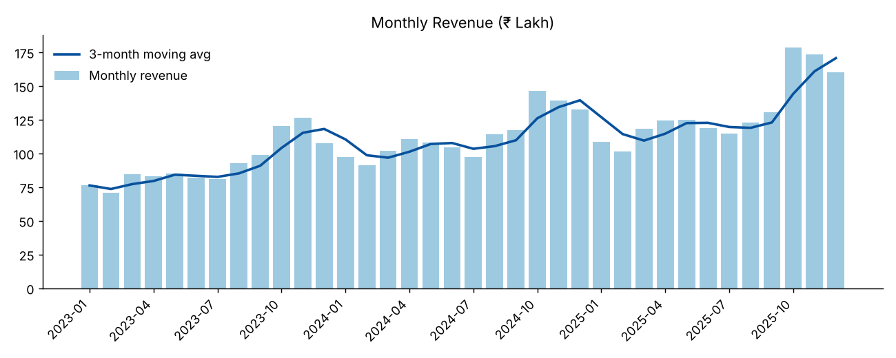
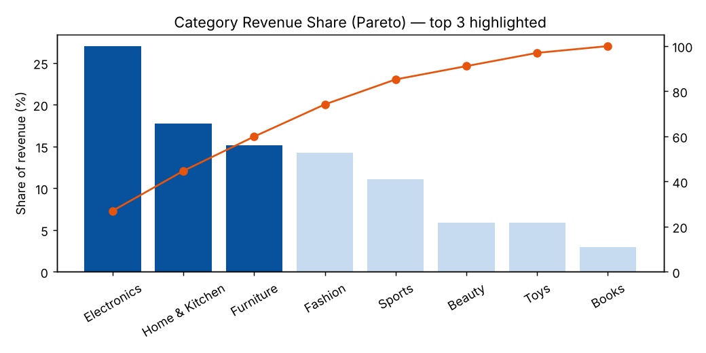
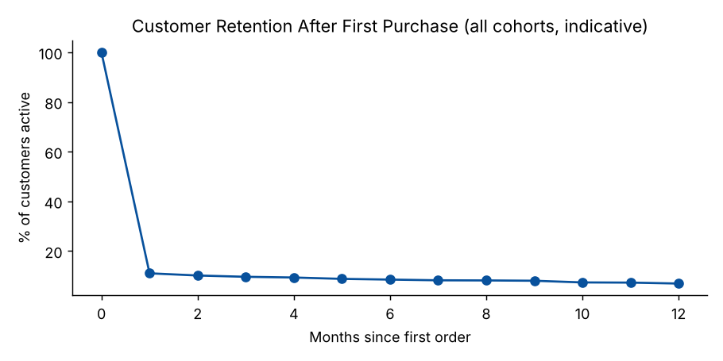

# Sales Analytics Dashboard

End-to-end analytics project: **Python ETL → MySQL star schema → SQL analytics → Power BI dashboard**.

**Tech stack:** Python · Pandas · NumPy · MySQL · SQLAlchemy · Power BI (DAX)

| | |
|---|---|
| Records processed | 121,800 raw order rows → **118,214** clean orders loaded |
| Data model | `fact_orders` + `dim_customers` (60K) + `dim_products` (64) + `dim_date` |
| SQL | 10 views + 10 ad-hoc queries using joins, CTEs, window functions |
| Dashboard | KPI cards, slicers, YoY / AOV / regional DAX measures, cohort-retention matrix |
| Tests | 10 pytest tests (cleaning rules + full pipeline reconciliation) |

> **About the data:** the dataset is **synthetic** (`src/generate_data.py`). It simulates three years of Indian e-commerce
> orders and deliberately injects real-world mess (duplicates, mixed date formats, missing values, negative quantities, orphan
> keys) so the cleaning pipeline has real work to do. The pipeline itself is dataset-agnostic — see
> `docs/INTERVIEW_GUIDE.md §8` to plug in a public dataset such as Olist or Superstore.

## Architecture

```
generate_data.py ──► data/raw/*.csv (dirty)
                          │
                      src/etl.py   (Pandas: clean · validate · derive · SQLAlchemy bulk load)
                          ▼
              MySQL  sales_analytics  (star schema)
                          │
                   sql/views.sql     (10 analytical views)
                          ▼
        ┌─────────────────┴──────────────────┐
   Power BI (live MySQL)            powerbi/exports/*.csv  +  docs/INSIGHTS.md  +  docs/charts/*.png
```

## Star schema

```
dim_date ──┐
dim_customers ──┼──► fact_orders (order_id, customer_id, product_id, order_date, quantity,
dim_products ──┘               unit_price, discount_pct, gross_amount, discount_amount,
                                net_revenue, payment_method, order_status, order_month, month_idx …)
```

## Quick start

```bash
# 1. Environment
python -m venv .venv && source .venv/bin/activate        # Windows: .venv\Scripts\activate
pip install -r requirements.txt

# 2a. Try it instantly with SQLite (no database setup)
python main.py --backend sqlite

# 2b. Or run on MySQL 8+
cp .env.example .env            # Windows: copy .env.example .env   → then edit your MySQL password
python main.py

# 3. Tests
pytest -q
```

`main.py` runs: generate data (first run only) → ETL → create views → export CSVs → `docs/INSIGHTS.md` + charts.
Use `--regen` to rebuild the raw data. The database `sales_analytics` is created automatically on MySQL.

## What the ETL does (`src/etl.py`)

| Rule | Handling |
|---|---|
| Duplicate orders | keep first per `order_id` |
| Missing / orphan keys | drop (cannot be attributed without guessing) |
| Mixed date formats (`YYYY-MM-DD`, `DD-MM-YYYY`), invalid dates | parse both; drop unparseable or out-of-range |
| Quantity ≤ 0 or > 100 | drop · missing quantity → 1 |
| Missing unit price | fill from product list price |
| Discount missing or outside 0–80% | set to 0 |
| Messy labels (`"cash on delivery"`, `"Home and Kitchen"`, `" NORTH "`) | standardise via mapping tables |
| Derived columns | `gross_amount`, `discount_amount`, `net_revenue`, `order_month`, `order_year`, `order_quarter`, `month_idx` |

A data-quality report is written to `data/etl_report.json` on every run.

## SQL highlights (`sql/views.sql`)

| View | Technique |
|---|---|
| `vw_monthly_revenue` | aggregation, `COUNT(DISTINCT)`, AOV |
| `vw_revenue_growth` | `LAG` for MoM and YoY growth, moving average with `ROWS BETWEEN`, YTD with `PARTITION BY` |
| `vw_yearly_summary` | CTE + `LAG` |
| `vw_category_revenue` | share of total (`SUM() OVER ()`), cumulative Pareto share, `RANK` |
| `vw_product_performance` | joins + `RANK` overall and `PARTITION BY category` |
| `vw_customer_summary` | lifetime value, repeat flag, `NTILE(5)` quintiles |
| `vw_cohort_retention` | cohort analysis (first-purchase month → months since first order) |
| `vw_regional_monthly`, `vw_region_summary` | regional trends and share |

More interview-style queries: `sql/analysis_queries.sql`.

## Power BI

1. Connect to MySQL (or load `powerbi/exports/*.csv`) — steps in [`powerbi/DASHBOARD_GUIDE.md`](powerbi/DASHBOARD_GUIDE.md).
2. Create relationships and paste the measures from [`powerbi/DAX_measures.md`](powerbi/DAX_measures.md).
3. Build the 3 pages (Executive Overview · Product & Category · Customers & Regions).
4. Save as `powerbi/Sales_Analytics_Dashboard.pbix` and add screenshots to `docs/screenshots/`.

## Results (from `docs/INSIGHTS.md`)

| KPI | Value |
|---|---|
| Revenue (completed orders) | ₹40.45 Cr across 104,285 orders |
| Average order value | ₹3,879 |
| Year-over-year growth | +22.8% (2024), +15.9% (2025) |
| Top 3 categories (Electronics, Home & Kitchen, Furniture) | **59.9%** of revenue |
| Repeat-customer rate | 63.9% · top 20% of customers = 63.1% of revenue |
| Seasonality | festive peak in October |





## Project structure

```
sales-analytics-dashboard/
├── main.py                  # one-command pipeline runner
├── src/
│   ├── config.py            # paths, settings, DB URL
│   ├── db.py                # SQLAlchemy engine + star-schema tables
│   ├── generate_data.py     # synthetic dirty dataset
│   ├── etl.py               # extract · transform · load
│   └── analysis.py          # views, exports, insights, charts
├── sql/                     # views.sql, analysis_queries.sql
├── powerbi/                 # DAX_measures.md, DASHBOARD_GUIDE.md, exports/
├── docs/                    # INSIGHTS.md, INTERVIEW_GUIDE.md, charts/
├── tests/                   # pytest suite
└── data/raw/                # generated CSVs
```

## Resume bullets

- Built an end-to-end ETL pipeline using Python, Pandas, and SQLAlchemy to clean, transform, and load 100K+ order records into MySQL.
- Developed SQL queries using joins, window functions, and views to analyze monthly revenue, customer retention, and top-performing products.
- Designed an interactive Power BI dashboard using KPI cards, slicers, and DAX measures to track year-over-year growth, average order value, and regional sales trends.
- Identified key business insights, including the top three product categories contributing approximately 60% of revenue.
